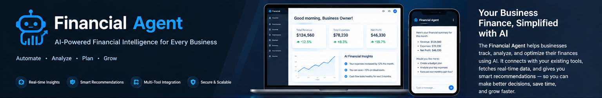
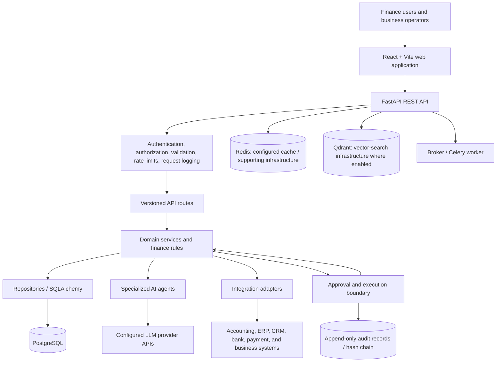

<div align="center">
  
  <h1>Financial Agent</h1>
  <p><strong>AI-assisted financial operations, insights, and decision support for businesses of every size.</strong></p>
  <p>Automate repetitive work · Understand financial performance · Make better-informed decisions</p>
  <p>
    
    
    
    
    
  </p>
</div>

> Financial Agent is a business-focused financial operations platform with AI-agent foundations. It is designed to help teams understand receivables, payables, cash movement, budgets, reconciliations, reporting, compliance workflows, and operational risk. It is **not limited to one ERP or one industry**. Existing systems can be connected through appropriate APIs, webhooks, import/export pipelines, and purpose-built adapters.

**Project status:** active development / technical validation required before production. See [production readiness notes](#production-readiness-and-limitations) before connecting live financial data.

---

## Contents

- [The business problem](#the-business-problem)
- [The solution](#the-solution)
- [Who can use it](#who-can-use-it)
- [Capabilities](#capabilities)
- [How it solves business problems](#how-it-solves-business-problems)
- [Architecture](#architecture)
- [End-to-end workflow](#end-to-end-workflow)
- [Integration strategy](#integration-strategy)
- [Technology stack](#technology-stack)
- [Repository structure](#repository-structure)
- [Getting started](#getting-started)
- [Configuration](#configuration)
- [API and documentation](#api-and-documentation)
- [Security and financial controls](#security-and-financial-controls)
- [Testing and quality checks](#testing-and-quality-checks)
- [Roadmap](#roadmap)
- [Contributing](#contributing)
- [Disclaimer](#disclaimer)

## The business problem

Many organizations manage financial operations across spreadsheets, accounting packages, bank portals, payment providers, ERP systems, CRM platforms, and email. When those tools are disconnected or processes are mostly manual, teams can face:

- **Fragmented visibility:** no single operational view of income, expenses, receivables, payables, cash, and budgets.
- **Manual reconciliation:** staff spend time matching bank activity, invoices, payments, vendors, and customers.
- **Slow collections:** overdue invoices and customer payment patterns can be hard to prioritize consistently.
- **Reactive cash planning:** teams may discover cash pressure only after commitments are due.
- **Reporting overhead:** finance teams repeatedly prepare summaries and explain changes across periods.
- **Inconsistent controls:** approvals, permissions, and evidence may be scattered across tools.
- **Integration friction:** replacing every existing system is costly, disruptive, and often unnecessary.

The result can be delayed decisions, avoidable rework, operational risk, and limited time for strategic financial planning.

## The solution

Financial Agent is intended to act as an **AI-assisted financial operations layer** around a business's existing systems. It combines conventional backend services and finance rules with specialized agents, APIs, reporting workspaces, approval workflows, and audit-oriented controls.

The platform is designed to:

1. Bring supported financial and operational data into a consistent workflow.
2. Apply deterministic business rules and calculations in backend services.
3. Use AI agents to summarize information, identify patterns, explain exceptions, and propose next steps.
4. Present results through an operational web interface and API.
5. Keep sensitive or consequential actions behind server-side authorization and, where implemented, explicit approval and execution boundaries.
6. Preserve existing systems as systems of record instead of requiring an immediate rip-and-replace migration.

**Important:** AI output is decision support, not a substitute for accounting policy, professional judgment, or approval by an authorized person. Actual integrations and automation depend on the adapter, configuration, permissions, and workflow implemented for each target system.

## Who can use it

The underlying financial workflows can apply across many business types. Examples below describe potential use cases, not a claim that every industry-specific connector or workflow is already production-ready.

| Business type | Example problems to address |
|---|---|
| Retail and e-commerce | Sales settlement checks, supplier bills, refunds, cash visibility, margin reporting |
| Services and agencies | Client invoicing, overdue receivables, project budgets, expense tracking |
| Manufacturing and distribution | Supplier payment planning, purchase-order visibility, cash commitments, vendor reconciliation |
| Healthcare and clinics | Expense visibility, receivable tracking, budget monitoring, finance reporting |
| Real estate and property management | Rent receivables, recurring expenses, vendor bills, property-level summaries |
| SaaS and technology companies | Recurring revenue reporting, operating costs, runway monitoring, budget variance |
| Education and non-profits | Fee or donation tracking, expense controls, departmental budgets, periodic reports |
| Small and medium businesses | Consolidated reporting and repeatable financial processes without replacing every current tool |

## Capabilities

The repository includes a substantial finance API and service layer, specialized agent modules, a React/Vite operations interface, and integration foundations. Feature availability must be validated against the relevant endpoint and workflow before use with live data.

### Finance operations

- **Accounts receivable:** customer invoices, receivable summaries, aging, and collections workflows.
- **Accounts payable:** vendor workflows, invoice handling, payment prioritization, and approval-related processes.
- **Bank reconciliation:** matching and reconciliation service foundations for financial records.
- **Payments and incoming payments:** payment-related workflows with server-side checks.
- **Budgets and treasury:** budget planning and cash/treasury-related service foundations.
- **Tax and compliance:** tax-related workflows and compliance-oriented agent modules.
- **Period close and reporting:** close-process support and financial reporting services.
- **Fraud and exception review:** agents and services intended to surface suspicious patterns and exceptions for review.
- **Audit and approvals:** approval inbox, typed execution boundaries, and audit-chain implementation.

### AI agent layer

Specialized modules in `app/agents/` cover areas including finance-director assistance, accounts receivable, accounts payable, bank reconciliation, collections, tax, treasury, budget planning, fraud detection, compliance, and external-system integration. LLM providers are configurable server-side. Agent outputs must be validated and reviewed according to the risk of the use case.

### Operations interface

The React/Vite frontend contains workspaces for areas such as dashboards, receivables, customer details, payables, vendor details, approvals, AI agents, reports, integration settings, audit, application settings, and login.

## How it solves business problems

| Business challenge | Financial Agent approach | Expected operational benefit |
|---|---|---|
| Staff manually assemble finance summaries | Centralized API-backed reporting and dashboard workspaces | Less repetitive reporting work |
| Overdue customer balances are difficult to prioritize | Receivables aging and collections-oriented workflows | Clearer follow-up priorities |
| Vendor bills and payment requests require coordination | AP workflows, prioritization, permissions, and approval-related processes | More consistent payment operations |
| Bank activity does not line up with internal records | Reconciliation services and matching logic | Faster exception identification, subject to data quality |
| Managers need forward-looking cash and budget visibility | Treasury, budget-planning, and AI-agent foundations | Better-informed planning conversations |
| Teams need to understand unusual activity | Fraud/compliance-oriented rules and agent modules | More focused human investigation |
| Existing business systems cannot easily be replaced | Adapter-based integration approach | Incremental adoption while retaining current systems of record |
| Important actions need traceability | Authorization, approval boundaries, and audit records | Better accountability and reviewability |

Benefits are intended outcomes, not guaranteed results. They depend on correct configuration, data quality, workflow adoption, integration coverage, and operational testing.

## Architecture

The backend owns financial calculations, authorization, persistence, approval state, integration calls, and audit records. The frontend displays backend-provided results; it should not independently calculate authoritative financial values.



### Architectural boundaries

- **Frontend:** React and Vite provide the operator interface and call API contracts.
- **API layer:** FastAPI routes validate requests and apply authentication/permission dependencies.
- **Domain layer:** finance services implement use cases and authoritative calculations.
- **Persistence:** SQLAlchemy and PostgreSQL store application records; Alembic manages schema migrations.
- **Agent layer:** specialized agents combine finance-specific context, structured schemas, and configurable model clients. LLM responses are untrusted input and must be validated.
- **Integration layer:** external-system communication is performed server-side, keeping credentials out of the browser.
- **Approval boundary:** AI recommendations and approval decisions are separate from execution. Only explicitly registered actions should be executable.
- **Audit layer:** audit records and verification facilities support traceability. Review the known limitations below before relying on them as a compliance control.
- **Supporting infrastructure:** Docker Compose defines PostgreSQL, Redis, Qdrant, the API, a worker, and the frontend for a local/staging-like stack.

### Typical request flow

1. A user signs in and opens a finance workspace.
2. The frontend calls a versioned API endpoint.
3. The API authenticates the user, derives current permissions, validates the request, and applies middleware.
4. A domain service loads records and performs deterministic finance calculations.
5. Where useful, an agent analyzes validated context and returns a structured recommendation or explanation.
6. The API returns a response with errors and correlation IDs handled consistently.
7. A consequential action follows its authorized workflow; where approval execution is implemented, approval remains separate from execution.

## Integration strategy

Financial Agent is designed to work alongside a business's current tools. It should not be presented as a universal plug-and-play connector: each integration requires an appropriate API, credentials, data mapping, error handling, and testing.

### Integration patterns

| Pattern | Suitable for | Considerations |
|---|---|---|
| REST API | Accounting, ERP, CRM, billing, inventory, and internal applications | Authentication, pagination, rate limits, mapping, retries, and API versioning |
| Webhooks | Payment events, invoice updates, transaction notifications | Verify signatures, deduplicate events, and handle out-of-order delivery |
| CSV / spreadsheet import-export | Legacy tools or systems without an API | Validate columns, currencies, dates, duplicate records, and source provenance |
| Scheduled synchronization | Systems that expose APIs but do not push events | Checkpointing, incremental sync, reconciliation, and retry policy |
| Custom adapter | Proprietary or industry-specific software | Keep provider-specific logic isolated from core finance services |

### Example integration plan

1. **Choose a source of truth.** Decide which system owns customers, vendors, invoices, payments, and account balances.
2. **Map the data.** Define stable IDs, currencies, timestamps, tax fields, statuses, and relationships.
3. **Start read-only.** Pull a small, bounded sample and validate authentication, TLS, pagination, and field mapping.
4. **Reconcile.** Compare source totals and record counts against the platform; document mismatches instead of silently guessing.
5. **Add event handling.** Use webhooks or scheduled sync with idempotency, deduplication, retry limits, and dead-letter/recovery procedures as appropriate.
6. **Introduce write actions cautiously.** Require explicit authorization, idempotency, approval where appropriate, and a recovery/reconciliation path for ambiguous outcomes.
7. **Monitor.** Log sync status, timestamps, correlation IDs, failed records, and operational alerts without leaking secrets or sensitive financial data.

### Integration examples

Potential targets include accounting packages, ERP systems, CRMs, banking APIs, payment processors, billing systems, inventory applications, and internal databases. Examples of provider categories include QuickBooks/Xero-style accounting tools, Salesforce/HubSpot-style CRMs, payment gateways, and custom ERP platforms. Compatibility must be verified for each provider and deployment; these examples do not imply that a connector is already implemented.

**Current integration boundary:** the repository contains SAP Business One Service Layer integration foundations. Its current documented interactive sync boundary is limited to customer/vendor master data; live verification against a real SAP tenant has not been completed. Financial document/payment writes should not be assumed available through the current interactive integration route. SAP is one optional adapter, not the product's overall scope.

## Technology stack

| Layer | Technology | Role |
|---|---|---|
| Backend API | Python, FastAPI, Uvicorn | REST endpoints and application lifecycle |
| Data validation | Pydantic | Request, response, and agent-output schemas |
| Persistence | SQLAlchemy async, PostgreSQL, asyncpg | Relational storage and data access |
| Schema migrations | Alembic | Versioned database migrations |
| Frontend | React, TypeScript, Vite | Finance operations interface |
| Authentication | JWT and persisted refresh sessions | Authentication and session management |
| Background / supporting services | Redis, Celery, RabbitMQ-compatible configuration | Supporting cache, task, and broker infrastructure where configured |
| Vector search | Qdrant client | Vector-search infrastructure where enabled |
| Model providers | Groq, Anthropic, OpenAI, Google Gemini clients | Configurable model access from the backend |
| Deployment | Docker, Docker Compose, Nginx | Local/staging-like container stack |
| Quality | pytest, Vitest, Playwright and static-analysis tools | Automated checks and test foundations |

## Repository structure

```text
finance-ai-platform/
├── app/
│   ├── agents/             # Specialized finance agents and model clients
│   ├── api/v1/             # Versioned REST API routes
│   ├── core/               # Configuration, middleware, errors, logging
│   ├── db/                 # Database models and session setup
│   ├── integrations/       # External system adapters
│   ├── repositories/       # Persistence/data-access boundaries
│   ├── schemas/            # Request/response contracts
│   ├── services/           # Finance rules and business use cases
│   └── workers/            # Background worker configuration
├── frontend/               # React/Vite application
├── alembic/                # Database migrations
├── docs/                   # Operational and go-live documentation
├── scripts/                # Developer and account setup helpers
├── tests/
│   ├── unit/               # Unit and contract tests
│   └── integration/        # Integration/API workflows
├── assets/                 # README and project visuals
├── docker-compose.yml      # Local/staging-like service composition
├── Dockerfile              # Backend image
├── requirements.txt        # Backend dependencies
├── requirements-dev.txt    # Development/testing dependencies
├── .env.example            # Configuration template (no real secrets)
├── ARCHITECTURE.md         # Additional architecture details
├── API_CONTRACT_MATRIX.md  # API contract inventory
├── SECURITY_REVIEW.md      # Security review and known issues
├── PROJECT_STATUS_AND_ROADMAP.md
└── README.md
```

## Getting started

### Prerequisites

- Python **3.12** (matches the backend Docker image)
- Node.js **20.19+** and npm (frontend engine requirement)
- PostgreSQL for manual local setup, or Docker with Docker Compose for the bundled stack
- Git
- Optional: API keys for the LLM provider you choose to configure

### Option A — developer helper (recommended)

From the repository root:

```bash
python scripts/dev.py setup
python scripts/dev.py user --email you@company.com --full-name "Your Name" --role finance_director
python scripts/dev.py run
```

Open the frontend at `http://localhost:3000`. The API is normally available at `http://localhost:8000`; interactive API docs are available at `http://localhost:8000/docs` when the app is not configured for production. On Windows, use `py -3.12 scripts\dev.py ...` if needed. Check the helper's current output if your local environment differs.

### Option B — Docker Compose

1. Create your local environment file:

   ```bash
   cp .env.example .env
   ```

   On Windows PowerShell, use `Copy-Item .env.example .env`.

2. Edit `.env` and set a strong `DB_PASSWORD` and `SECURITY_JWT_SECRET_KEY`. Never commit `.env`.
3. Build and start the stack:

   ```bash
   docker compose up --build
   ```

4. Open `http://localhost:3000`. The API health endpoint is `/api/v1/health/ready`; API port and supporting services are bound locally according to the Compose configuration.
5. Create a user from the API container when needed:

   ```bash
   docker compose exec api python scripts/create_user.py --email you@company.com --full-name "Your Name" --role finance_director
   ```

This Compose setup is intended for local development or staging-like evaluation. It is not a complete production orchestration/security design.

### Option C — manual backend and frontend setup

Create and activate a virtual environment, install dependencies, configure `.env`, and run database migrations.

**Windows PowerShell (backend):**

```powershell
py -3.12 -m venv .venv
.\.venv\Scripts\Activate.ps1
Copy-Item .env.example .env
pip install -r requirements.txt -r requirements-dev.txt
alembic upgrade head
uvicorn app.main:app --reload --host 127.0.0.1 --port 8000
```

**macOS/Linux (backend):**

```bash
python3.12 -m venv .venv
source .venv/bin/activate
cp .env.example .env
pip install -r requirements.txt -r requirements-dev.txt
alembic upgrade head
uvicorn app.main:app --reload --host 127.0.0.1 --port 8000
```

In a second terminal:

```bash
cd frontend
npm install
npm run dev
```

The frontend development server uses the configured `/api` proxy. See `frontend/vite.config.*` and the frontend documentation if your API runs on a different host or port.

## Configuration

`.env.example` documents supported configuration fields. Copy it to `.env` and set only the values needed for your environment.

| Variable group | Purpose |
|---|---|
| `APP_*` | Application name, environment, debug mode, CORS, trusted proxy configuration |
| `DB_*` | PostgreSQL connection settings |
| `REDIS_*` | Redis host, port, and database |
| `BROKER_*` | Background/event broker configuration |
| `QDRANT_*` | Vector database connection settings |
| `SECURITY_*` | JWT secret, token lifetimes, registration policy |
| `LLM_*` | Default model provider and server-side API keys |
| `SAP_*` | Optional SAP Business One integration settings |

Security rules:

- Do not commit `.env`, passwords, API keys, tokens, customer data, bank data, or production exports.
- Use a unique, high-entropy `SECURITY_JWT_SECRET_KEY` outside local-only development.
- Keep provider credentials on the server. Never expose secrets through `VITE_*` variables or browser code.
- Keep TLS certificate verification enabled for external integrations.
- Use least-privilege service accounts and separate development, test, staging, and production credentials.

## API and documentation

When running locally with documentation enabled:

- Swagger UI: `http://localhost:8000/docs`
- ReDoc: `http://localhost:8000/redoc`
- Readiness endpoint: `http://localhost:8000/api/v1/health/ready`

The API is versioned under `/api/v1`. Route modules cover authentication, customers, vendors, invoices, payments, receivables/aging, bank reconciliation, budgets, reports, approvals, agents, audit, and integration status/verification. Consult the route definitions and `API_CONTRACT_MATRIX.md` for the current endpoint contracts; endpoint behavior and permissions should not be inferred from a feature name alone.

## Security and financial controls

Financial applications require stronger safeguards than a typical demo dashboard. The project includes several defensive patterns, but they do not eliminate the need for independent security and finance review.

- **Server-side authorization:** protected requests resolve the active user and derive permissions from persisted role information.
- **Short-lived access tokens and refresh sessions:** refresh sessions are persisted and designed to be rotated/revocable.
- **Validation and error handling:** request schemas and consistent error responses reduce ambiguous client behavior.
- **Rate limiting and security headers:** middleware provides baseline API protections; deployment topology affects how these behave.
- **Approval/execution separation:** AI suggestions are not equivalent to authorization to execute a financial action.
- **Allowlisted execution:** consequential operations should use explicit typed actions, not arbitrary frontend or model-generated method names.
- **Audit trail:** append-only audit-chain implementation and a verification endpoint support integrity checks.
- **Currency awareness:** summaries should not add monetary values across currencies without a valid conversion policy and rates.
- **Integration safety:** keep credentials server-side, use TLS verification, avoid blind retries for ambiguous non-idempotent mutations, and reconcile uncertain outcomes.

Read `SECURITY_REVIEW.md`, `FINAL_TECHNICAL_AUDIT.md`, `SAP_INTEGRATION.md`, and `docs/GO_LIVE_CHECKLIST.md` before any deployment handling real financial records.

## Testing and quality checks

Run the checks relevant to your environment and record their results; do not describe a check as passing unless it has actually run successfully.

**Backend tests:**

```bash
python -m pytest tests/unit tests/integration -v
```

If your test environment supports coverage:

```bash
python -m pytest tests/unit tests/integration -v --cov=app --cov-report=term-missing
```

**Frontend checks** (from `frontend/`):

```bash
npm run typecheck
npm run lint
npm test
npm run build
npm run test:e2e
npm run test:a11y
```

**Additional backend static/security checks** (when dependencies are installed):

```bash
ruff check .
black --check app tests alembic
mypy app
bandit -r app -x tests
pip-audit -r requirements.txt
```

CI configuration is in `.github/workflows/ci.yml`. Some integration checks require a running PostgreSQL instance, external credentials, or other services. Mocked contract tests do not prove compatibility with a real third-party environment.

## Production readiness and limitations

**This repository's own acceptance notes mark it as not production-ready.** Treat it as an active engineering project until all relevant checks are completed in a controlled environment.

Known boundaries called out in the project documentation include:

- Full backend tests against PostgreSQL, frontend typecheck/lint/unit/build, browser end-to-end/accessibility tests, dependency audits, and a complete Docker Compose startup still require execution and review in a suitable environment.
- Live connectivity to a real SAP Business One tenant has not been verified by this project delivery.
- Current SAP agent sync is restricted to customer/vendor master data; financial-document and payment writes must not be assumed available through the interactive route.
- Multi-factor authentication and single sign-on are not implemented.
- The rate limiter is process-local; horizontal API scaling requires a shared/distributed rate-limit design.
- No automatic cross-currency conversion should be assumed. Monetary totals must remain separated by currency unless a reviewed exchange-rate and accounting policy is implemented.
- Audit records written in the same transaction as a business action can roll back with that transaction; an independent sink for all failure events is not yet implemented.
- LLM availability, output quality, cost, and provider behavior depend on external configuration. AI-generated explanations and recommendations need evaluation and appropriate human review.
- Production operations still require secret management, backups and restore drills, monitoring/alerting, incident response, access reviews, retention policies, capacity testing, and jurisdiction-specific compliance review.

Before go-live, work through `docs/GO_LIVE_CHECKLIST.md`, resolve each applicable blocker, and document evidence of successful tests and operational sign-off. Do not connect live financial data simply because the application starts locally.

## Roadmap

A practical evolution path for a business-agnostic financial assistant:

- [ ] Complete and publish reproducible backend, frontend, and end-to-end test results.
- [ ] Define stable, provider-neutral integration contracts for accounting, banking, payment, ERP, and CRM systems.
- [ ] Add integration health dashboards, sync checkpoints, dead-letter handling, and reconciliation reports.
- [ ] Expand idempotent, approval-bound actions only after failure recovery and audit requirements are validated.
- [ ] Add model evaluation datasets, agent quality monitoring, prompt/version management, and cost controls.
- [ ] Strengthen production identity controls, including MFA/SSO where required.
- [ ] Add observability, backup/restore drills, load testing, and a documented incident-response process.
- [ ] Validate multi-currency reporting against an explicit exchange-rate and accounting policy.
- [ ] Add industry-specific templates only where customer needs and data governance are understood.

## Contributing

Contributions are welcome. For a useful pull request:

1. Open an issue describing the business problem and proposed behavior.
2. Keep finance calculations in backend domain services rather than duplicating them in the frontend.
3. Add or update schemas, tests, API contracts, and relevant documentation.
4. Include failure cases for permissions, duplicate events, external API errors, currencies, and ambiguous financial mutations where applicable.
5. Run the checks relevant to the changed code and state clearly what could not be run.
6. Never include real financial data, credentials, or secrets in commits, fixtures, logs, or screenshots.

## Disclaimer

Financial Agent is software in active development and is provided for engineering evaluation. It is not financial, tax, legal, investment, or accounting advice. No claim is made that every integration, agent, or workflow is production-ready or certified for any regulatory framework. Validate calculations, permissions, audit requirements, and integrations with qualified professionals before using the platform for consequential business decisions.

---

<div align="center">
  <strong>Financial Agent · Smarter financial operations for every business.</strong>
  <br />
  Built to connect existing tools, surface useful insights, and keep people in control of important decisions.
</div>
